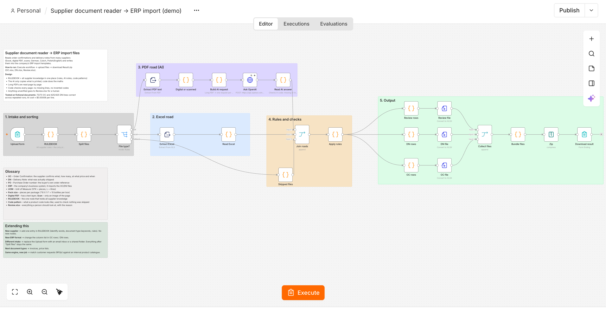
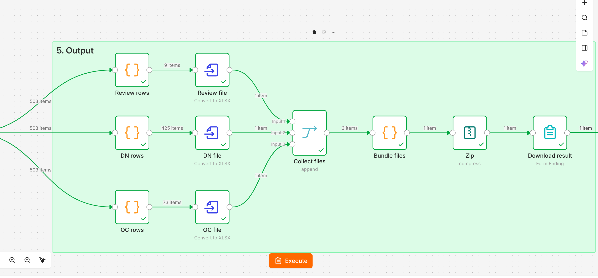

# AI Supplier Document Reader (n8n)

**Turns supplier order confirmations and delivery notes (PDF, Excel or scanned paper, in German, Czech and Polish) into ERP-ready import files, and reports every line it could not verify.**

| 498 / 498 | ≈ $0.04 | ≈ 6 hours |
|:---:|:---:|:---:|
| lines read correctly across repeated runs | AI cost per full run | of manual typing replaced per run |

**Built with:** n8n · JavaScript · OpenAI Responses API (strict JSON Schema)



> All companies and documents in the test set are fictional. They reproduce the structure and traps of real supplier documents.

---

## The problem

A car-parts distributor's purchasing team typed every supplier document into the ERP by hand, at about **45 seconds per line**. The difficulties:

- **35–40 suppliers**, each with its own layout, in German, Czech and Polish
- **Three file types:** digital PDFs, Excel exports and scanned paper
- **Units that don't match the ERP:** "2 boxes of 10 × 1 l" has to become 20 pieces
- **Missing or hidden data:** one supplier never prints its own name; another hides the order number in a free-text note
- **Long documents:** one delivery note runs to 14 pages and 395 lines across 3 purchase orders

Suppliers can't be asked to change their formats, so the automation has to work with what they send.

I built this from a real client engagement. The client decided not to go ahead, so I finished it as a portfolio case on a fictional test set that reproduces the same formats.

---

## How it works

| File in | How it's read |
|---|---|
| **Excel** | Read directly in code. No AI. |
| **Digital PDF** | AI transcribes page by page, then code checks the result against the PDF's text layer |
| **Scan** | AI transcribes, and every line is flagged for a human check |

Everything then goes through **one Rulebook** (per-supplier keywords, unit conversions and AI notes) and comes out as:
- **OC.xlsx / DN.xlsx**: ERP import files for order confirmations and delivery notes
- **Review.xlsx**: every line that couldn't be verified, with the reason

### Three design choices

1. **The AI copies, the code calculates.** The model transcribes values exactly as printed, into a strict JSON Schema. JavaScript does every conversion, so the AI never does a calculation it could get wrong.
2. **AI only where it's needed.** Excel files are read in code. When a document arrives as both PDF and Excel, only the Excel is read.
3. **One Rulebook.** All supplier knowledge lives in one config node. Adding a supplier means adding one entry, not building new nodes.

---

## The failure that shaped the design

During testing, the 14-page delivery note came back with **21 of 395 lines**, only page 1. **The run still finished green and reported no error.** In production, 374 lines would have gone missing without anyone noticing.

Two changes fixed it:

1. **Long PDFs are read one page at a time.** Anything over 4 pages (a Rulebook setting) is split into separate AI requests and joined back together in code.
2. **Every page is checked against its own text.** Code finds every product code printed on the page, using a pattern for each supplier, and compares that list with the AI's answer. A missing code means a skipped line. An extra code means an invented one. Both go to Review.xlsx, with the codes named.

Scans have no text layer to check against, so every line read from a scan goes to review.

> An automation that can be wrong must also be able to tell you when it is wrong. Every uploaded file ends up either in the import files or in the review file, with a reason.

---

## Results

Tested against a hand-checked expected answer for all 12 documents:

| Test | Result |
|---|---|
| Order confirmation lines | **73 of 73** correct |
| Delivery note lines | **425 of 425** correct |
| Upload only the Excel files | Works. Only Excel lines are returned. |
| Upload only the PDFs | Works. The 14-page note is read page by page. |
| Simulated "lazy" AI that skips lines | **Caught.** The missing codes are listed in Review.xlsx. |
| AI cost | ≈ $0.00008 per line, ≈ $0.04 per full run |
| Manual typing, for comparison | ≈ 45 s per line, ≈ 6 hours for 498 lines |



---

## Try it (about 15 minutes)

You need **n8n 2.x** (self-hosted or Cloud) and an **OpenAI API key**. A full run costs a few cents.

1. Import `workflow/supplier-docs-automation.json` into n8n (**⋯ menu → Import from File**).
2. In the **Ask OpenAI** node, create your own OpenAI credential. The one referenced in the file is mine and won't work for you.
3. Click **Execute workflow** and upload the files from `sample-data/`. Leave out `Expected_result.xlsx` and `README.md`.
4. Download `Result.zip` and open `Review.xlsx` first.
5. Compare the result with `sample-data/Expected_result.xlsx`.

The full guide, with troubleshooting, is in [docs/How to Run.pdf](docs/How%20to%20Run.pdf).

---

## Repository contents

```
workflow/        the n8n workflow (JSON)
sample-data/     12 fictional supplier documents, 2 ERP templates, the expected result
sample-output/   the result of a real run (OC.xlsx, DN.xlsx, Review.xlsx)
docs/            Case Study.pdf and How to Run.pdf
screenshots/     workflow and output images
```

---

## What production would need

- **Supplier entries:** one Rulebook entry per supplier, built from 2–3 sample documents each and tested against a known answer
- **Intake:** a shared mailbox or folder instead of the upload form. Everything after the file split stays the same.
- **Pilot:** a short run on live documents with the purchasing team checking Review.xlsx before any line goes into the ERP unchecked
- **Data & hosting:** a data agreement and a hosting choice, since supplier documents are sent to an AI provider

## Extending it

- **New ERP format:** change the column list in the *OC rows* / *DN rows* nodes
- **Next document types:** invoices, price lists
- **Same engine, new job:** match customer requests (RFQs) against an internal product catalogue

---

## Glossary

- **OC**: Order Confirmation. The supplier confirms what, how many, at what price and when.
- **DN**: Delivery Note. What was actually shipped.
- **PO**: Purchase Order number. The buyer's own order reference.
- **ERP**: the company's business system, which imports the OC/DN files
- **UOM**: Unit of Measure (STK = pieces, L = litres)
- **Pack size**: pieces per package ("10 X 1 l" = 10 bottles per box)
- **Digital PDF / Scan**: a digital PDF has a text layer; a scan is only an image of the page
- **Code pattern**: what a product code looks like, used to check that nothing was skipped

---

**Florin Baras** · AI & automation builder · [LinkedIn](#) · [Demo video](#)
